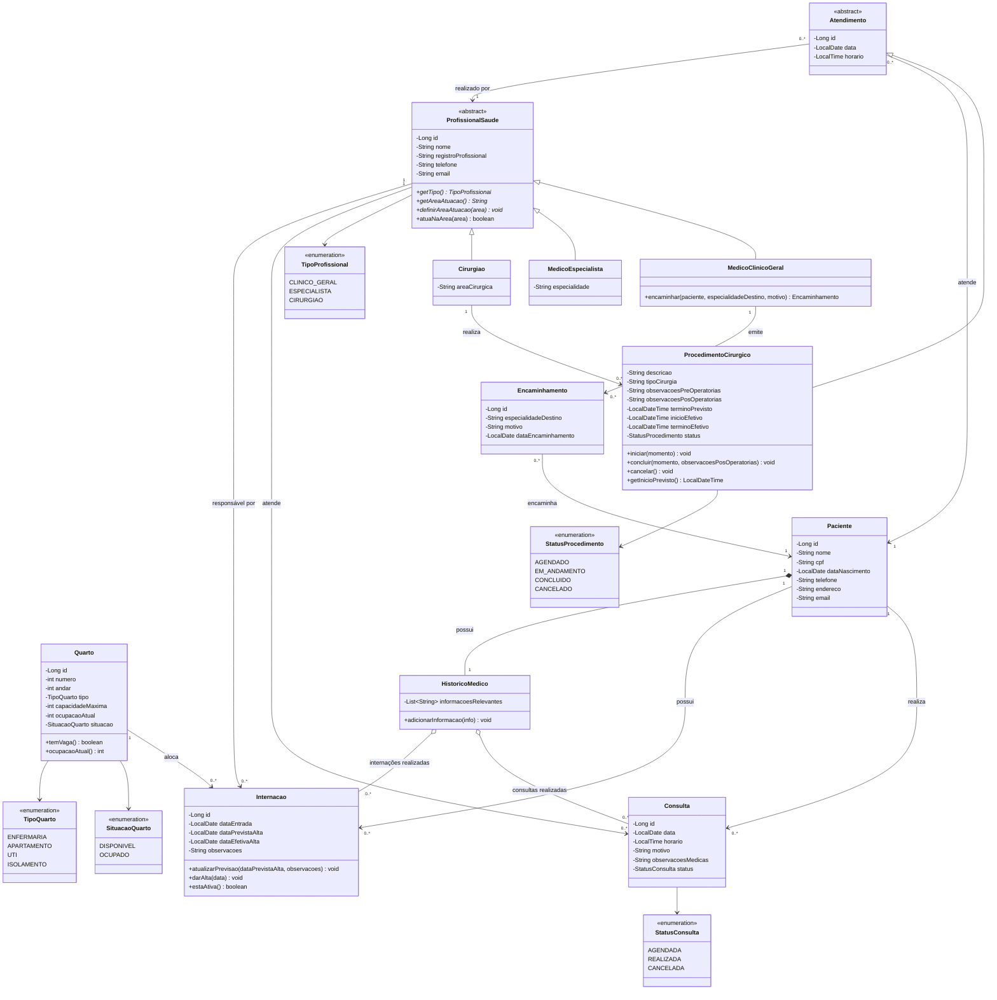

# Diagrama de Classes

Camada Model do Sistema Hospitalar (renderizado automaticamente pelo GitHub).

## Regras de negócio refletidas no modelo

- Consulta exige paciente e profissional responsável (RN2); o profissional não pode ter dois atendimentos no mesmo horário (RN3, verificada pela interface `AgendaProfissional` da camada Service).
- Internação exige paciente e quarto disponível (RN4); o quarto não ultrapassa `capacidadeMaxima` (RN5, validada em `temVaga`). Só a `Internacao` ocupa ou libera vaga do `Quarto`, e a situação do quarto é recalculada a cada mudança. Um paciente não tem duas internações ativas ao mesmo tempo.
- `ProcedimentoCirurgico` herda de `Atendimento` e só é realizado por `Cirurgiao`. O status segue AGENDADO → EM_ANDAMENTO → CONCLUIDO; não é possível concluir um procedimento que não foi iniciado, nem cancelar um já concluído.
- `HistoricoMedico` consolida consultas e internações do paciente (RN1 e RN6).
- Só o médico clínico geral emite `Encaminhamento`. O médico especialista exige especialidade e o cirurgião exige área cirúrgica.
